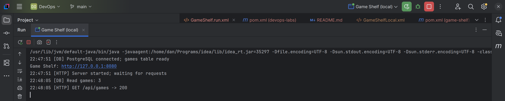
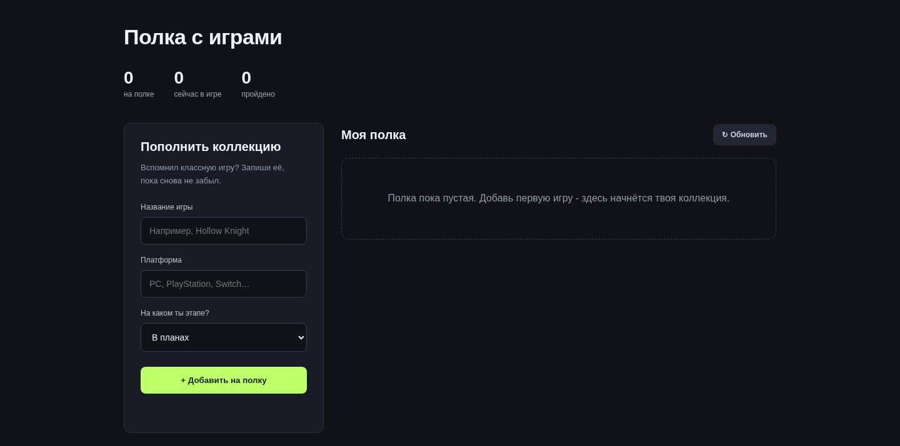
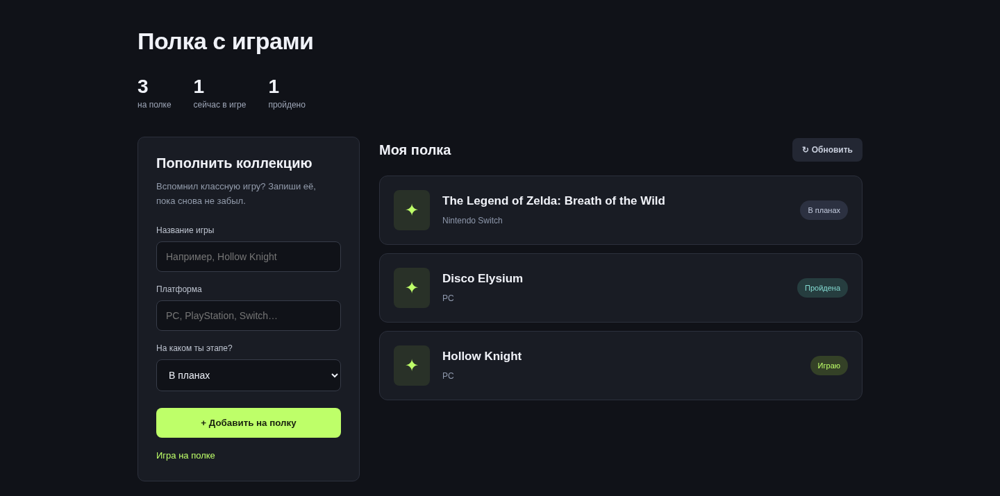
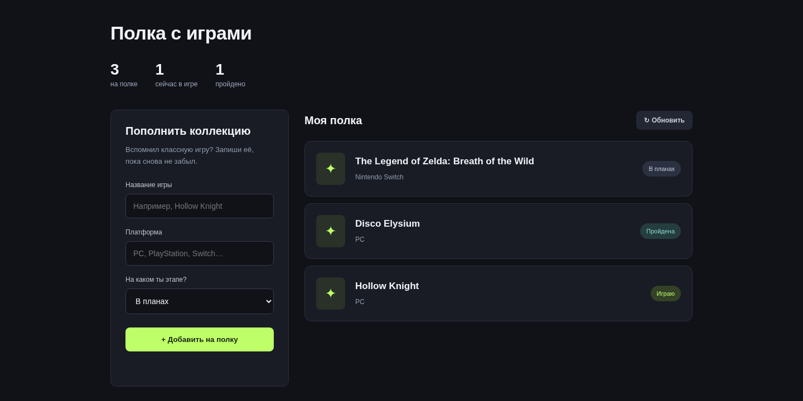
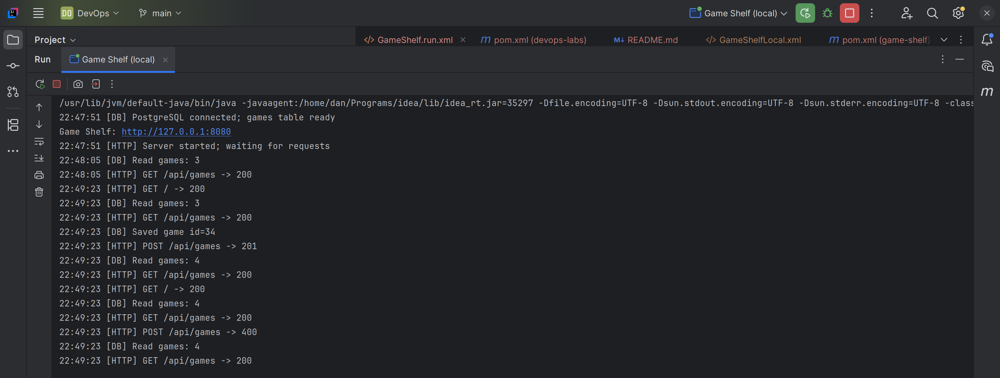

# Лаба 0. Полка с играми

Мы сделали небольшую полку для видеоигр. Увидел игру, решил пройти потом, записал сюда. Когда появилось свободное время, открыл список и выбрал, во что сыграть.
У каждой игры название, платформа и статус: «В планах», «Играю» или «Пройдена». Сверху видно, сколько игр всего и сколько уже пройдено.
Лаба мз 3 частей состоит: страница в браузере, сервер на Java и бд PostgreSQL.

## 1. Как запустить

После клонирования репозитория лаба лежит в папке `lab0`.

Для запуска вот это всё должно быть установлено:

1. JDK 21
2. IntelliJ IDEA
3. PostgreSQL 17. Стандартный порт 5432, пароль пользователя `postgres`.
4. pgAdmin, если он свм не установилcя вместе с PostgreSQL. Через него один раз подготовим базу.


## 2. Создаём пользователя и базу, только один раз

если PostgreSQL ещё не готов, бэк не сможет запустится. Поэтому:

1. Надо открыть pgAdmin.
2. В Servers подключиться к своему PostgreSQL под пользователем `postgres` с паролем, который задали при установке.
3. Если до сих пор не подключилось, то нажмите Servers -> Register -> Server. Назовите `Local PostgreSQL`, в Connection из таблицы всё закинуть и всё.

| Поле | Значение |
| --- | --- |
| Host name / address | `127.0.0.1` |
| Port | `5432` |
| Maintenance database | `postgres` |
| Username | `postgres` |
| Password | пароль от PostgreSQL |

4. Потом выберить базу postgres и открыть Tools -> Query Tool. В редактор вставить эту команду и нажатть кнопку выполнения запроса:

   ```sql
   CREATE ROLE gamer LOGIN PASSWORD 'gamer_local';
   ```

5. Потом выполнить отдельно, с включённым Auto commit:

   ```sql
   CREATE DATABASE games OWNER gamer;
   ```

6. И обновить список через Refresh. И games там появится.

Теперь у приложения есть база `games` и пользователь `gamer`. Таблицу с играми оно создаст само при первом старте.

ТОЛЬКО НЕ ПУТАТЬ пароли. `postgres` нужен нам для настройки сервера. `gamer` нужен самой полке, и мы только что задали ему пароль `gamer_local`. При каждом следующем запуске эти SQL-команды повторять не нужно.

## 3. Запускаем в IDEA

1. После клона открыть папку через File -> Open.
2. загрузить проект и зависимости, соглашаемя.
3. Потом File -> Project Structure -> Project SDK и JDK 21. Если отдельно спрашивается SDK модуля, то тот же JDK или наследование Project SDK.
4. Ну и запускаем файл `lab0/src/main/java/com/gameshelf/Main.java`.
5. И если внизу такое:



6.то открываем в браузере **[http://127.0.0.1:8080](http://127.0.0.1:8080)**.

Адрес `127.0.0.1` означает сам пк. Порт `8080` использует Java, а `5432` использует PostgreSQL.

## 4. Проверка

### Открытие пустой полки



### Добавить игры

Ну тут максимально дефолтно всё, хаполнить и закинуть и всё.



### Перезагрузка

После перезагрузки всё на месте всё хорошо.



## 5. Логи сервера

По сообщениям можно понять, какой запрос пришёл и что сделал сервер.



Разобрать их можно так:

1. **`GET / -> 200`**: браузер запросил страницу, Java её отдала.
2. **`[DB] Read games: 3`**: Java прочитала из базы три игры. Число меняется вместе с коллекцией.
3. **`[DB] Saved game id=...`**: PostgreSQL сохранил новую запись и выдал ей номер.
4. **`POST /api/games -> 201`**: запрос на добавление завершился успешно.
5. **`GET /api/games -> 200`**: страница получила свежий список. После добавления Portal 2 в нём уже четыре игры.
6. **`POST /api/games -> 400`**: сервер отклонил некорректную форму. В этой проверке название было пустым, запись в базу не попала.

## 6. Как всё работает (наверное нет, но всё равно наверное надо.) чеее ахах

Допустим, я добавляю Hollow Knight. Вот весь путь записи:

1. Я заполняю форму в браузере и нажимаю кнопку.
2. JavaScript собирает поля и отправляет **POST /api/games** в Java.
3. Java проверяет название, платформу и статус.
4. Через JDBC-драйвер Java выполняет **INSERT** в PostgreSQL.
5. PostgreSQL сохраняет строку в таблице **games**.
6. Java возвращает успешный ответ, а страница запрашивает список через **GET /api/games** и показывает новые карточки.

```text
Браузер -> Java на порту 8080 -> PostgreSQL на порту 5432
```

Здесь **фронтенд** находится в `src/main/resources/static/index.html`. HTML задаёт форму, CSS отвечает за внешний вид, JavaScript делает запросы и выводит игры.

**Бэкенд** находится в `src/main/java/com/gameshelf/Main.java`. Это Java-приложение со стандартным HTTP-сервером из JDK. Оно отдаёт страницу и выполняет запросы к базе.

**PostgreSQL** работает отдельным процессом. Даже на одном компьютере Java подключается к нему по сети.

В таблице `games` хранятся номер записи `id`, название `title`, платформа `platform`, статус `status` и время добавления `created_at`. Номер и время выдаёт сама база. При старте Java создаёт таблицу, только если её ещё нет, поэтому старые игры не стираются.

После F5 страница заново запрашивает список. Java выполняет **SELECT** в PostgreSQL и возвращает сохранённые строки. Поэтому записи переживают и обновление вкладки, и перезапуск Java. В `localStorage` коллекция не хранится.

## 7. Как увидеть игры прямо в базе -_-

Если хочется проверить без участия сайта, сделай так:

1. Открой pgAdmin в Query Tool выпонлить запрос:

   ```sql
   SELECT id, title, platform, status, created_at
   FROM games
   ORDER BY id;
   ```


А по адресу [http://127.0.0.1:8080/api/games](http://127.0.0.1:8080/api/games) можно посмотреть ответ Java в JSON. Из этих данных страница и собирает карточки.

## 8. Если порт или пароль у вас другой

С настройками из инструкции Java ждёт базу **games** на **127.0.0.1:5432**, пользователя **gamer** и пароль **gamer_local**. Всё хрошо должно быть

Еслис чето там с PostgreSQL по другому:

1. Run -> Edit Configurations -> запуск Java -> Environment variables. Если поля не видно то добавить  через **Modify options**.
4. указывае эти параметры:

| Переменная | Значение по умолчанию |
| --- | --- |
| `DB_URL` | `jdbc:postgresql://127.0.0.1:5432/games` |
| `DB_USER` | `gamer` |
| `DB_PASSWORD` | `gamer_local` |
| `PORT` | `8080` |


## 9. Если не запустилось, куда смотреть

В окне Run. Оно обычно сразу подсказывает, на каком месте всё остановилось.

| Сообщение | Что сделать |
| --- | --- |
| `Connection refused` | Включить PostgreSQL и проверить порт в `DB_URL` |
| `Password authentication failed` | Проверить пользователя `gamer` и его пароль |
| `database "games" does not exist` | Создать базу `games` на нужном сервере PostgreSQL |
| `Address already in use` | Остановить предыдущий запуск Java или поменять `PORT` |
| Ошибка версии Java | Выбрать JDK 21 или новее в Project SDK и SDK модуля |
| Не найден JDBC-драйвер | Дождаться загрузки зависимостей, проверить интернет и перезагрузить проект из `pom.xml` |

