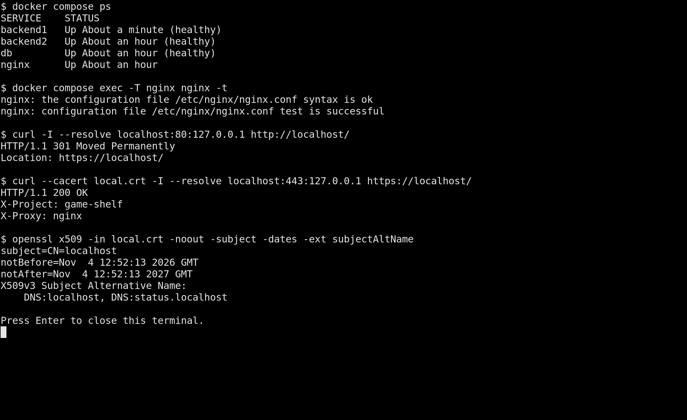
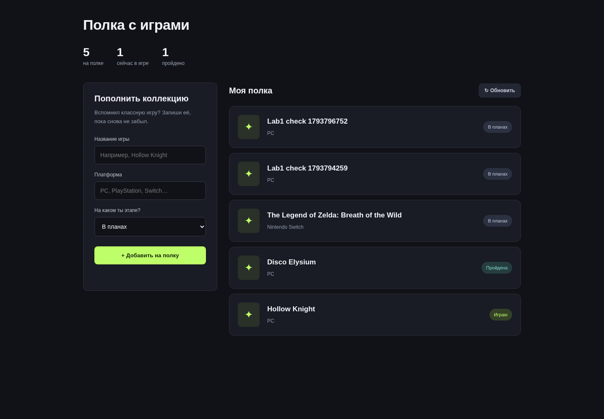
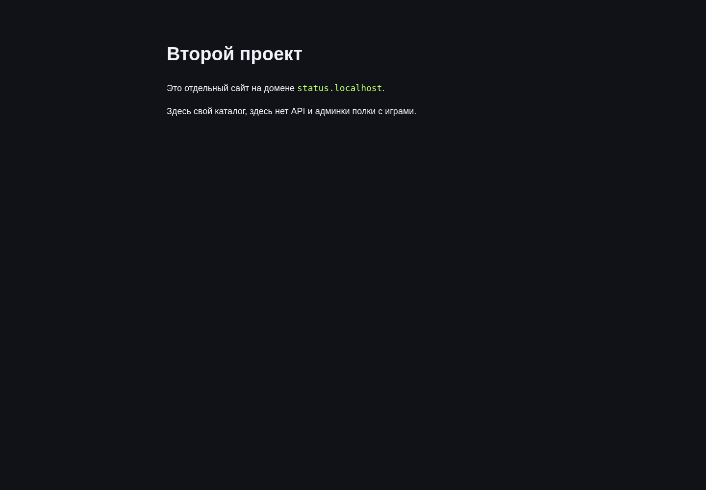
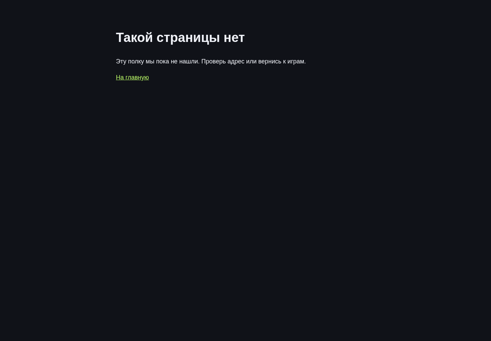
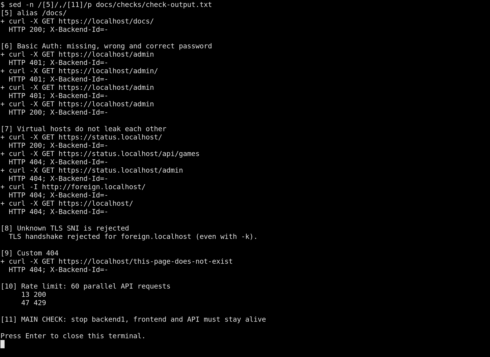
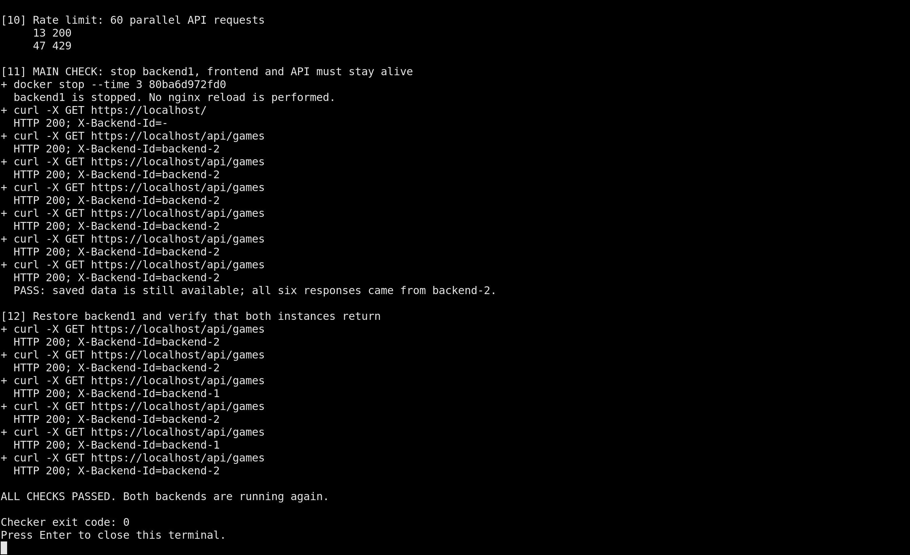

# Лаба 1. Полка с играми nginx

В нулевой лабе мы сделали полку с играми. А в этой сделали если один бэкенд упадёт, то сайт всё равно будет работать.

Закинули всё на nginx и запустил две копии java. Теперь браузер приходит в nginx, а тот выбирает, какой копии передать запрос. Одна если падает, то список игр всё равно продолжит загружаться через вторую.
## Что здесь запущено

```text
Браузер
  HTTP :80 → редирект на HTTPS :443
                         │
                       nginx
                  /             /api/*
                  │                │
            HTML, CSS, JS       upstream games
                                /          \
                       backend-1:8081   backend-2:8082
                                \          /
                                 PostgreSQL
```

Страница и api остаются на том же домене. html nginx читает сам, к java идут только запросы `/api`. Оба бэкенда используют одну базу, и видят одинаковые игры.

Для этой лабы мы прсото взяли копию сервиса из lab0 и закинули заголовок X-Backend-Id. сама java его выставляет и там в ответе видно какой из двух обработал запросы.

## Как запустить

1. установить и включить docker desktop. и потом ждать пока запустится docker engine
2. открыть репозиторий в idea, потом открыть её терминал.
3. в репозитории перейти в папку лабы
4. запустить весь стенд

   ```text
   docker compose up -d --build
   ```

5. на всякий проверьте nginx и конфиг

   ```text
   docker compose ps --all
   docker compose exec -T nginx nginx -t
   ```

   там должно быть healthy, у nginx Up, и контейнер `setup` завершится с кодом 0 т к он один раз готовит сертификат и файл паролей.

Вот терминал после настройки:



6. открыть **[https://localhost](https://localhost)**.cертификат самоподписанный и браузер предупредит о нём. Для локального стенда надо подтвердь переход через доп настройки (ну там внизу обычно).
7. Ну и добавляем игру через форму и обновляем страницу. и запись остаётся

Основной адрес `localhost` уже указывает на сейчасшний пк, второй сайт открывается по `status.localhost`, если браузер тоже направит его локально и это имя не открывается, то просто надо вот так написать и всё:

```text
127.0.0.1 status.localhost
```

На винде файл находится в `C:\Windows\System32\drivers\etc\hosts`, редактируется с правами администратора. В маке (вкусно и точка хыыыы) это `/etc/hosts`. для скрипта проверок эта настройка не нужна т к он сам задаёт адрес соединения через curl.

Полка открывается уже через https и nginx:



## Куда можно зайти

| Адрес | Что там                                           |
| --- |---------------------------------------------------|
| `https://localhost/` | полка с играми, статику отдаёт nginx              |
| `https://localhost/api/games` | api                                               |
| `https://localhost/docs/` | отдельная папка через `alias`                     |
| `https://localhost/admin` | basic auth, логин `admin`, пароль `lab1_password` |
| `https://status.localhost/` | второй сайт со своим каталогом                    |
| `http://localhost/` | перенаправление 301 на https                      |

Пароль админки можно поменять через `ADMIN_PASSWORD` в `.env` перед запуском (если надо, хотя кому это надо :) ). В репозитории нет tls-ключа и готового файла htpasswd т к они создаются при запуске и остаются в Docker volumes.

Вот второй проект. Он работает на том же ip и порту, но nginx выбирает другой каталог по имени хоста:



А такой ответ получаем при переходе на несуществующую страницу полки:



## Запуск проверок всех требований

Из папки `lab1` выполнить:

```text
docker compose run --rm checker
```

Внутри запускается [tools/check.sh](tools/check.sh). Сам файл написан для shell, но на винде не нужен bash, т к там всё внутри контейнера. Снаружи одна и та же команда Compose для всех систем.

Скрипт делает следующее:

1. проверяет http 301 и адрес перенаправления
2. открывает https с проверкой  сертификата через `--cacert`
3. запрашивает api несколько раз и проверяет, что встретились оба `X-Backend-Id`
4. сохраняет запись через post и читает её обратно из psql
5. проверяет `alias`, админку без пароля, с неверным и с правильным паролем
6. проверяет второй домен, неизвестный host и отказ для неизвестного tls имени
7. ищет нашу страницу 404
8. отправляет 60 параллельных запросов и проверяет наличие 429
9. останавливает backend1, проверяет главную страницу и шесть ответов api через backend2. Сохранённая запись должна быть в каждом ответе
10. запускает backend1 обратно и смотрит что оба экземпляра снова участвуют в балансировке

Если какой то пункт не пройдёт то  скрипт ошибку выкинет. При прерывании он тоже пытается вернуть остановленный им бэкенд. Каждая проверка добавляет одну запись с названием `Lab1 check ...` в базу

Весь вывод автоматом сохраняется в [docs/checks/check-output.txt](docs/checks/check-output.txt). Скрин проверок авторизации, доменов и ограничения запросов:



## Один бэкенд выключен, сайт отвечает

В этой проверке контейнер останавливается через `docker stop`. nginx между остановкой и запросами не перезапускается и не перечитывает конфиг.

После остановки все шесть запросов вернули 200 а в заголовке был backend-2. Значит всё работает и всё круто



Если хочется повторить руками:

1. открываем полку, добавляем игру
2. остановливаем первую копию:

   ```text
   docker compose stop backend1
   ```

3. обновляем страницу. Список должен загрузиться
4. Смотрим заголовки api:

   ```text
   curl -k -i --resolve localhost:443:127.0.0.1 https://localhost/api/games
   ```

   В PowerShell используем `curl.exe`, чтобы не попасть в псевдоним. Для этой ручной команды `-k` нужен из за локального самоподписанного сертификата. проверка автомвтом использует `--cacert` и сертификат проверяет.

5. возвращаем контейнер:

   ```text
   docker compose start backend1
   ```

6. ждём и повторяем запросы. В ответах снова появятся оба идентификатора


## Что мы настроили в nginx и зачем

- https: сертификат с именами обоих сайтов
- статика отдельно: root /srv/games и try_files обслуживают страницу без обращения к java
- балансировка: в upstream games два сервера с одинаковым весом, запросы распределяются round robin
- повторная попытка: `proxy_next_upstream` разрешает попробовать вторую копию при ошибке соединения или таймауте. max_fails=1 временно убирает недоступный сервер из выбора
- общая база: переключение экземпляра не меняет коллекцию. Обе java подключаются к одному psql
- alias: `/docs/` указывает на `/srv/docs/`, папка лежит вне каталога сайта.
- домены: для второго проекта свой `server` и свой `root`. Его `/api/games` и `/admin` возвращают 404. Неизвестный http host получает 404, неизвестное tls имя отклоняется ещё при рукопожатии
- лимит: 10 запросов в секунду на ip, небольшой burst 10, превышение даёт 429. ограничен только api
- админка: защищены и `/admin`, и `/admin/` с вложенными страницами. пароли проверяются по хешам в htpasswd
- ошибки: у полки своя 404 и страница 50x для ошибок самого nginx

адреса бэкендов nginx определяет при старте или reload. Обычный `stop/start` сохраняет сетевые настройки контейнера. Если пересоздавать контейнеры после изменения кода, надо закинуть ноые адреса:

```text
docker compose up -d --build --force-recreate
```

## конфиг nginx

конфиг [nginx/nginx.conf](nginx/nginx.conf), настройки прокси [nginx/snippets/api.conf](nginx/snippets/api.conf).
В настройках прокси не включён повтор уже отправленных неидемпотентных (ну которые могут много раз отпраляться и перезаписывать) запросов: это помогает не сохранить игру дважды при обрыве post

## Полный вывод проверки

<details>
<summary>Вывод docker compose run --rm checker</summary>

```text
LAB1 CHECKS | 2026-11-04 12:52:31 UTC
HTTPS requests use --cacert /tls/local.crt and --connect-to (see check.sh).
Displayed curl commands omit these repeated options and form/auth arguments.

[1] HTTP -> HTTPS
+ curl -I http://localhost/
  HTTP 301; X-Backend-Id=-
  Location: https://localhost/

[2] Frontend is served directly by nginx
+ curl -X GET https://localhost/
  HTTP 200; X-Backend-Id=-

[3] Round robin: both Java instances answer
+ curl -X GET https://localhost/api/games
  HTTP 200; X-Backend-Id=backend-1
+ curl -X GET https://localhost/api/games
  HTTP 200; X-Backend-Id=backend-2
+ curl -X GET https://localhost/api/games
  HTTP 200; X-Backend-Id=backend-1
+ curl -X GET https://localhost/api/games
  HTTP 200; X-Backend-Id=backend-2
+ curl -X GET https://localhost/api/games
  HTTP 200; X-Backend-Id=backend-1
+ curl -X GET https://localhost/api/games
  HTTP 200; X-Backend-Id=backend-2

[4] Write to PostgreSQL through the proxy
+ curl -X POST https://localhost/api/games
  HTTP 201; X-Backend-Id=backend-1
{"id":8}
+ curl -X GET https://localhost/api/games
  HTTP 200; X-Backend-Id=backend-2

[5] alias /docs/
+ curl -X GET https://localhost/docs/
  HTTP 200; X-Backend-Id=-

[6] Basic Auth: missing, wrong and correct password
+ curl -X GET https://localhost/admin
  HTTP 401; X-Backend-Id=-
+ curl -X GET https://localhost/admin/
  HTTP 401; X-Backend-Id=-
+ curl -X GET https://localhost/admin
  HTTP 401; X-Backend-Id=-
+ curl -X GET https://localhost/admin
  HTTP 200; X-Backend-Id=-

[7] Virtual hosts do not leak each other
+ curl -X GET https://status.localhost/
  HTTP 200; X-Backend-Id=-
+ curl -X GET https://status.localhost/api/games
  HTTP 404; X-Backend-Id=-
+ curl -X GET https://status.localhost/admin
  HTTP 404; X-Backend-Id=-
+ curl -I http://foreign.localhost/
  HTTP 404; X-Backend-Id=-
+ curl -X GET https://localhost/
  HTTP 404; X-Backend-Id=-

[8] Unknown TLS SNI is rejected
  TLS handshake rejected for foreign.localhost (even with -k).

[9] Custom 404
+ curl -X GET https://localhost/this-page-does-not-exist
  HTTP 404; X-Backend-Id=-

[10] Rate limit: 60 parallel API requests
     13 200
     47 429

[11] MAIN CHECK: stop backend1, frontend and API must stay alive
+ docker stop --time 3 80ba6d972fd0
  backend1 is stopped. No nginx reload is performed.
+ curl -X GET https://localhost/
  HTTP 200; X-Backend-Id=-
+ curl -X GET https://localhost/api/games
  HTTP 200; X-Backend-Id=backend-2
+ curl -X GET https://localhost/api/games
  HTTP 200; X-Backend-Id=backend-2
+ curl -X GET https://localhost/api/games
  HTTP 200; X-Backend-Id=backend-2
+ curl -X GET https://localhost/api/games
  HTTP 200; X-Backend-Id=backend-2
+ curl -X GET https://localhost/api/games
  HTTP 200; X-Backend-Id=backend-2
+ curl -X GET https://localhost/api/games
  HTTP 200; X-Backend-Id=backend-2
  PASS: saved data is still available; all six responses came from backend-2.

[12] Restore backend1 and verify that both instances return
+ curl -X GET https://localhost/api/games
  HTTP 200; X-Backend-Id=backend-2
+ curl -X GET https://localhost/api/games
  HTTP 200; X-Backend-Id=backend-2
+ curl -X GET https://localhost/api/games
  HTTP 200; X-Backend-Id=backend-1
+ curl -X GET https://localhost/api/games
  HTTP 200; X-Backend-Id=backend-2
+ curl -X GET https://localhost/api/games
  HTTP 200; X-Backend-Id=backend-1
+ curl -X GET https://localhost/api/games
  HTTP 200; X-Backend-Id=backend-2

ALL CHECKS PASSED. Both backends are running again.
```

</details>

Полный журнал nginx во время проверки: [nginx-access.txt](docs/checks/nginx-access.txt).

## где что лежит и как выключить

```text
lab1/
  compose.yaml
  backend/              Java и Dockerfile бэкенда
  nginx/                nginx.conf и настройки прокси
  web/games/            фронтенд, админка и страницы ошибок
  web/status/           второй проект
  postgres/init.sql     пользователь приложения
  tools/setup.sh        сертификат и htpasswd
  tools/check.sh        curl, проверки и остановка бэкенда
  docs/public/          файлы для alias /docs/
  docs/checks/          сохранённый вывод проверок
  docs/screenshots/     скриншоты
```

Посмотреть запросы nginx и выбранные экземпляры:

```text
docker compose logs --tail 30 nginx
docker compose logs --tail 20 backend1 backend2
```

Выключить стенд:

```text
docker compose down
```

База, сертификат и htpasswd остаются в volumes и при след `docker compose up -d` игры сохранятся. Команда `docker compose down -v` удаляет эти данные, для обычной остановки она не нужна.

В итоге сайт пережил остановку одной копии бэкенда. Снаружи адрес не поменялся, nginx просто передал запросы второй копии, и `все жили долго и счастливо!`

