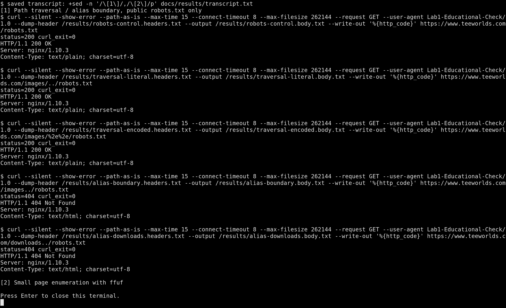
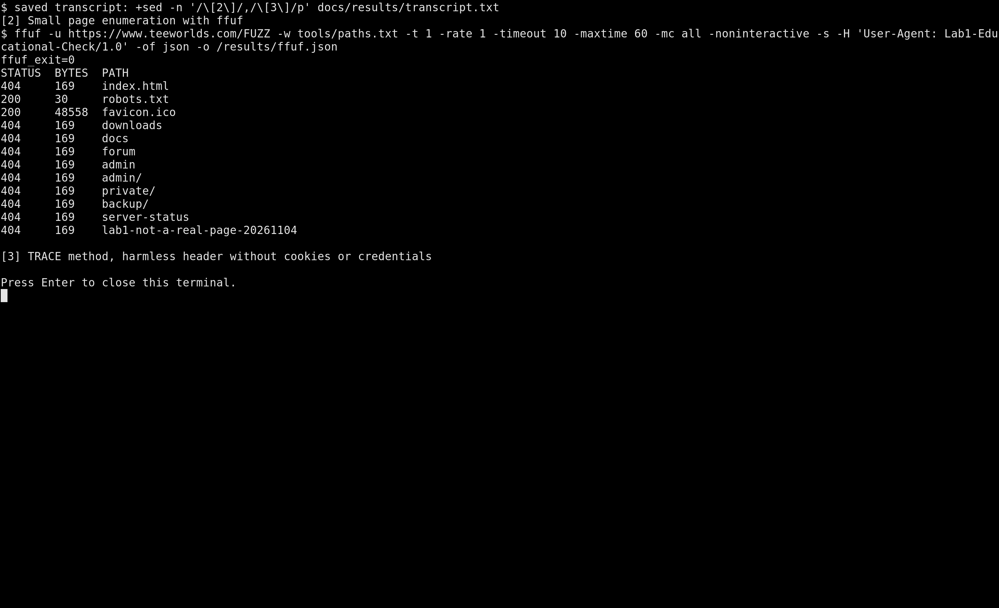
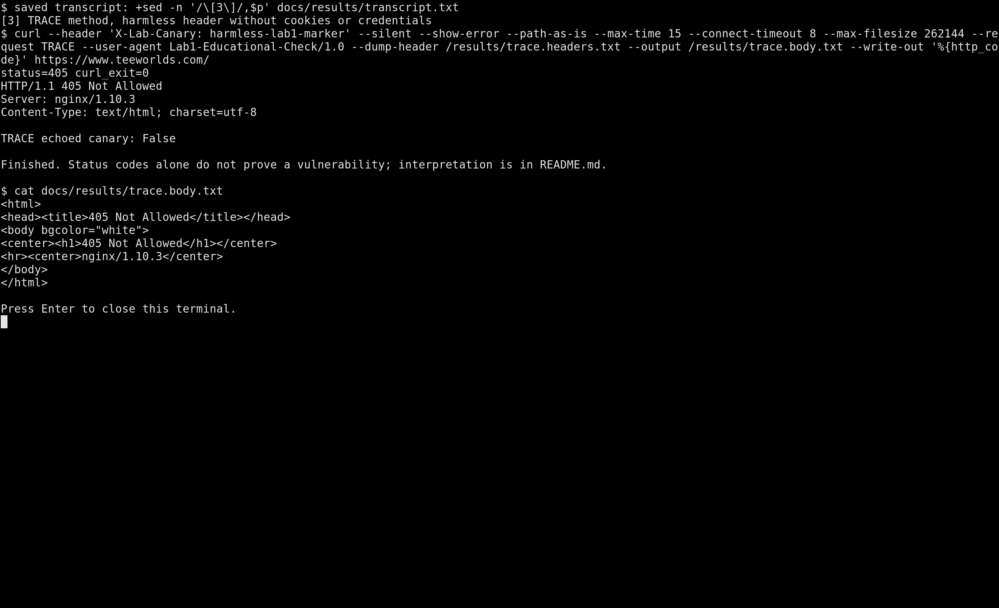

# Лаба 1* Типа взламываем сайт Teeworlds :)

После проверки главная страница ответила `200`, а в заголовке пришло `Server: nginx/1.10.3`. Ну и так понятно что по одному заголовку непонятно и не видно все настройки сервера. Поэтому дальше читсо на ответы на конкретные запросы ориентировались.


## Что и как проверяли

Вот эти пункты взяли:

1. обход путей: прокатит ли через `..` выйти из каталога, особенно при ошибке в `alias`
2. поиск страниц через ffuf: не торчит ли наружу админка или служебный каталог
3. метод trace: не палит ли сервер переданные заголовки обратно

всего отправили 20 запросов: 8 через curl и 12 через ffuf. curl работает последовательно с паузами, ffuf ограничен одним потоком и одним запросом в секунду. Переходов по редиректам, рекурсивного поиска, подбора паролей и изменения данных нет. Для обхода только взяли публичный `robots.txt`, без попыток читать пароли или сист файлы

## Обход путей и возможная ошибка alias

Идея такая: `..` означает переход на уровень выше. Если nginx неправильно связывает адрес с каталогом на диске, похожий запрос иногда позволяет выйти за разрешённую папку (кайфик ухехехе). Особенно интересна граница имени `location` и пути `alias`.
сначала запросили обычный `/robots.txt`, чтобы было с чем сравнивать. потом закинули такие пути:

| Путь | Ответ | Что получилось                                       |
| --- | --- |------------------------------------------------------|
| /robots.txt | 200 | контрольный публичный файл                           |
| /images/../robots.txt | 200 | тот же публичный файл                                |
| /images/%2e%2e/robots.txt | 200 | тот же публичный файл с закодированными точками      |
| /images../robots.txt | 404 | проверенный вариант обхода границы alias не сработал |
| /downloads../robots.txt | 404 | второй вариант тоже не сработал                      |

в curl стоит `--path-as-is`: без него клиент мог бы убрать `..` ещё до отправки запроса, ну и смысл бы там был бы

Сначала два ответа `200` выглядят подозрительно, но это не взлом (оййй конечно не взлом иди поспи ахах, хакер мамин): сервер просто привёл путь к `/robots.txt`, который и так открыт всем. Тела этих трёх ответов совпали, это видно по [SHA-256](docs/results/body-hashes.txt). Доступа к закрытым данным здесь нету



по итогу в проверенных адресах выход за разрешённый каталог не получилось сделать, т к конфига чужого nginx у нас нет, поэтому мы также не утверждаме что там вообще такие `alias` есть

## Поиск страниц через ffuf

иногда служебная страница просто не имеет ссылки в меню но открывается, если угадать адрес. Проверили вот это [список из 12 путей](tools/paths.txt), включая `admin`, `private/`, `backup/` и `server-status`.
Команда из запуска:

```text
ffuf -u https://www.teeworlds.com/FUZZ -w tools/paths.txt -t 1 -rate 1 -timeout 10 -maxtime 60 -mc all -noninteractive -s -H "User-Agent: Lab1-Educational-Check/1.0" -of json -o /results/ffuf.json
```

`FUZZ` заменяется очередной строкой из файла и `-t 1` оставляет один поток, `-rate 1` задаёт один запрос в секунду, а `-mc all` сохраняет все статусы, включая `404`. Параметры можно сверить с [документацией ffuf](https://github.com/ffuf/ffuf).

Нашли тольок публичные `/robots.txt` и `/favicon.ico`, оба с `200`. Остальные десять путей ответили `404`, в том числе `admin`, `admin/`, `private/`, `backup/` и `server-status`. Несуществующий контрольный адрес тоже дал `404`, так что это не сайт, который отвечает `200` на любой текст в url



Сырые результаты: [ffuf.json](docs/results/ffuf.json), [вывод самого ffuf](docs/results/ffuf-console.txt).

Ну по итогу доступных служебных страниц в этом списке не нашлось. Само обнаружение страницы ещё не означало бы взлом: нужно было бы показать доступ туда, куда пользователь не должен попадать.

## Проверка TRACE

TRACE предназначен для диагностики и может возвращать полученный запрос в теле ответа. Хотели проверить, не включено ли такое отражение заголовков. Передали только безобидную метку `X-Lab-Canary: harmless-lab1-marker`, без cookie и авторизации.

```text
curl -i --max-time 15 -X TRACE -H "X-Lab-Canary: harmless-lab1-marker" https://www.teeworlds.com/
```

Сервер ответил **`405 Not Allowed`**, метка в теле ответа не появилась



Ну и витоге отражение запроса через TRACE не обнаружено. Даже разрешённый TRACE сам по себе ещё не доказывал бы кражу данных, т к метод вообще отклонён

## Как посмотреть результаты и повторить

скриншоты и ответы уже лежат в `docs`. Например, [requests.json](docs/results/requests.json) содержит статусы всех восьми запросов curl, а файлы `*.headers.txt` и `*.body.txt` сохраняют исходные ответы.

Если нужно повторить этот же короткий запуск:

1. Надо надо запустить Docker Desktop
2. Открыть терминал в корне клонированного репозитория и перейти в папку:

   ```text
   cd lab1_zvezdochka
   ```

3. собрать инструменты:

   ```text
   docker compose build
   ```

4. запустить проверку один раз:

   ```text
   docker compose run --rm audit
   ```

5. открыть `docs/results/transcript.txt`

Python, curl и ffuf уже находятся внутри контейнера. Устанавливать их не нужно

Сам скрипт находится в [tools/audit.py](tools/audit.py)

## Получилось ли взломать
Ну КОНЕЧНО КОНЕЧНО ЖЕ не получилось

