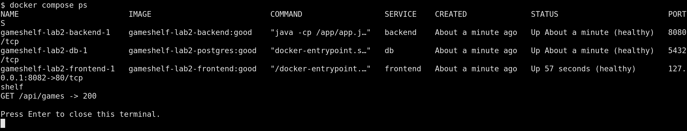
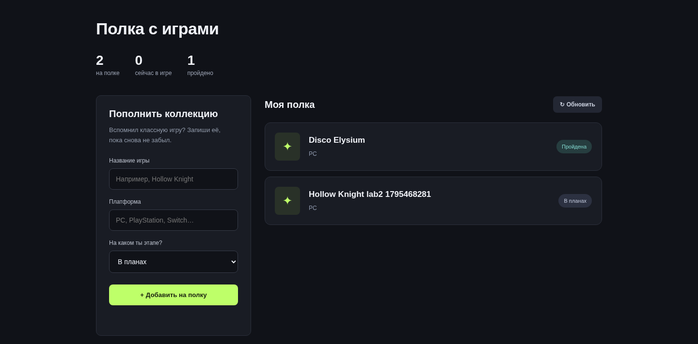
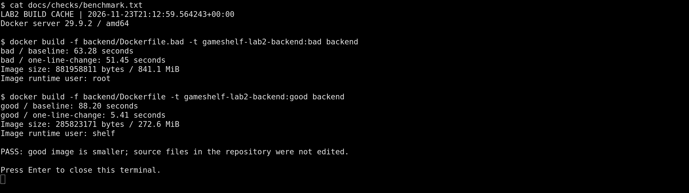
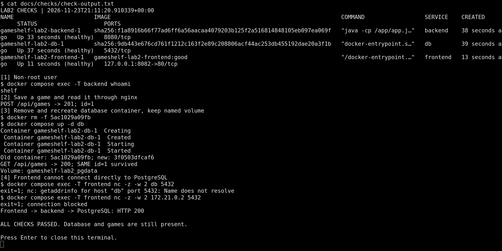

# Лаба 2. Упаковываем полку в Docker

Сама полка уже сохраняет игры в pqsl. Теперь хочется запустить её без установки java, maven и базы на свой пк. Для этого мы собрали контейнеры: один со страницей, второй с java, третий с psql

Ещё сделали две упаковки бэкенда. Одна специально неудачная: большая, с root и неудобным кешем. Вторая исправляет эти вещи
## Как запустить

1. установить и запустить Docker desktop. На Windows выберить Linux containers, на маке обычного Docker desktop хватит
2. отклонить репозиторий, открой его папку в idea или терминале и перейти в лабу:

   ```text
   cd lab2
   ```

3. и запустить всё сразу, все три сервиса командой:

   ```text
   docker compose up -d --build
   ```

  
4. смотрим, всё ли поднялось:

   ```text
   docker compose ps
   ```

   У `frontend`, `backend` и `db` должно появиться `healthy`
5. открыть [http://localhost:8082](http://localhost:8082), добавить игру и обновить страницу. Если запись осталась, то всё хорошо





порт `8082` должен быть свободен. Старые лабы останавливать не обязательно: здесь свой Compose-проект `gameshelf-lab2`, свои сети и том базы. Соседняя звёздочка открывается на `8083` и хранит игры отдельно.

## как это общается между собой

```text
Браузер -> localhost:8082 -> frontend (nginx)
                              |
                         сеть web
                              |
                         backend (Java)
                              |
                         сеть data
                              |
                         db (PostgreSQL)
                              |
                       том pgdata с играми
```

nginx отдаёт html, css и js, а `/api/games` передаёт java. Бэкенд читает и записывает psql. Браузеру нужен только один адрес, и настраивать cors не пришлось

В сети `web` находятся фронт и бэк. В сети `data` только бэк и бд, причём она объявлена `internal`. Порт psql наружу не опубликован. Фронт не подключён к этой сети, поэтому поговорить с базой напрямую не может

Файлы для запуска: [compose.yaml](compose.yaml), [конфиг nginx](frontend/nginx.conf), [подготовка базы](postgres/init.sql). Исходники полки лежат в [backend](backend), страница в [frontend/web/index.html](frontend/web/index.html)


## что плохого в плохом dockerfile

[Dockerfile.bad](backend/Dockerfile.bad) собирает рабочее приложение, но плохо

| плохой                                               | что исправили в хорошем                                                            |
|------------------------------------------------------|------------------------------------------------------------------------------------|
| плавающий тег Maven                                  | зафиксировали базу сборки digest, среда запуска также имеет точную версию и digest |
| копирование всего проекта перед maven                | сначала копируем `pom.xml` и зависимости, потом исходники                          |
| maven, полный jdk, исходники и кеш остались в runtime | Multi-stage build, в финале только jre, jar и jdbc драйвер                         |
| запуск от root                                       | cоздали пользователя `shelf` и указал `USER shelf`                                 |
| нет healthcheck                                      | проверяем `/health`, который делает запрос к psql                                  |

Плохой образ тоже проверили запуском: api вернул `200`, а `whoami` показал `root`. [Вывод](docs/checks/bad-runtime.txt)

Digest здесь можно понимать как отпечаток конкретного образа, тег может поменяться, а этот отпечаток указывает на ту же сборку. jdk и maven нужны для сборки java, для запуска уже готового приложения хватит jre

jdk нужен для компиляции, jre только для запуска. Поэтому компилятор и maven можно оставить на этапе сборки и не носить их в готовом контейнере. Digest фиксирует конкретный образ, даже если его тег потом изменится

допом [.dockerignore](backend/.dockerignore) убирает `target`, `.git`, настройки ide и `.env` из контекста. Он действует на обе сборки: сравнение не строится на случайно попавшем туда мусоре.

<details>
<summary>плохой Dockerfile целиком</summary>

```dockerfile
# Плохо: тег плавающий, новая сборка может получить другую базу.
FROM maven:3.9-eclipse-temurin-21
WORKDIR /app
# Плохо: любая правка исходников сбрасывает слой с загрузкой зависимостей.
COPY . .
RUN mvn -B -q -DskipTests package dependency:copy-dependencies
# Плохо: Maven, JDK, исходники и кеш зависимостей остаются в готовом образе.
# Плохо: USER не задан, поэтому приложение работает от root.
# Плохо: HEALTHCHECK отсутствует, о готовности приложения Docker не знает.
CMD ["java", "-cp", "target/backend-lab2-1.0.0.jar:target/dependency/*", "com.gameshelf.lab2.Main"]
```

</details>

<details>
<summary>хороший Dockerfile целиком</summary>

```dockerfile
# Digest фиксирует базу сборки, даже если тег позже изменится.
FROM maven:3.9-eclipse-temurin-21@sha256:99e61abcff91a9b1333463bd8451fb18495d6eba9250ac66a338b518f8278320 AS build
WORKDIR /build
# Зависимости меняются реже кода, поэтому этот слой идёт первым.
COPY pom.xml .
RUN mvn -B -q -DskipTests dependency:go-offline dependency:copy-dependencies
COPY src ./src
RUN mvn -B -q -o -DskipTests package

FROM eclipse-temurin:21.0.9_10-jre-alpine@sha256:08eecc477dbe3f2e33daac27f36e41daf7f4ec51d2f3396006e54fa41832c74c
WORKDIR /app
RUN addgroup -S shelf && adduser -S -G shelf shelf
# В runtime переносим только приложение и JDBC-драйвер, без Maven и исходников.
COPY --from=build --chown=shelf:shelf /build/target/backend-lab2-1.0.0.jar ./app.jar
COPY --from=build --chown=shelf:shelf /build/target/dependency ./lib
ENV HOST=0.0.0.0 PORT=8080 JAVA_TOOL_OPTIONS="-Xms16m -Xmx192m -XX:ActiveProcessorCount=2"
USER shelf
EXPOSE 8080
HEALTHCHECK --interval=5s --timeout=3s --start-period=15s --retries=6 CMD wget -q -O /dev/null http://127.0.0.1:8080/health || exit 1
ENTRYPOINT ["java", "-cp", "/app/app.jar:/app/lib/*", "com.gameshelf.lab2.Main"]
```

</details>

В Compose запускается только хороший вариант. Плохой нужен для сравнения. Проверка `docker compose exec -T backend whoami` вернула **`shelf`**. У плохого образа та же проверка через `docker run --entrypoint whoami` вернула `root`.

## размер и кеш

| измерение                                       | плохой образ | хороший |
|-------------------------------------------------|-------------:|--------:|
| размер из `docker image inspect` мб             |        841.1 |   272.6 |
| пересборка после изменения одной строки, секунд |        51.45 |    5.41 |
| пользователь                                    |         root |   shelf |

что именно измеряил:

1. для каждого dockerfile собрали исходный вариант, чтобы существовал его кеш
3. повторили `docker build` и измерили полное время команды через `time.perf_counter()`
4. сохранилb полный buildkit лог каждой сборки.

У плохого варианта изменение кода сбросило `COPY . .` и следующий `RUN mvn ...`. Пришлось заново выполнять Maven вместе с загрузкой зависимостей. У хорошего слой с `pom.xml` и зависимостями остался `CACHED`, повторились копирование исходников и компиляция



Замеры: [benchmark.txt](docs/checks/benchmark.txt), [benchmark.json](docs/checks/benchmark.json). Полные логи после правки: [плохая сборка](docs/checks/build-bad-one-line-change.log), [хорошая сборка](docs/checks/build-good-one-line-change.log).

Повторить сравнение из папки `lab2`:

```text
docker compose build checker
docker compose run --rm --entrypoint python3 checker tools/benchmark.py
```

Скрипт сам выполняет обе сборки. Отдельно плохой образ можно собрать так:

```text
docker build -f backend/Dockerfile.bad -t gameshelf-lab2-backend:bad backend
```

## проверка данных и изоляции

снчала скрипт сохранил игру через api, затем действительно выполнил `docker rm -f` для контейнера бд. После `docker compose up -d db` появился контейнер с другим id, но та же игра с тем же id осталась в базе т к данные находятся в томе `gameshelf-lab2_pgdata`, а не в файловой системе контейнера

Потом из фронта пробуем подключиться к psql:

по имени `db`: имя не разрешается в сети фронта

по настоящему ip бд и порту `5432`: соединение тоже не проходит

через `/api/games`: ответ `200`, значит сама база доступна бэкенду и работает



[Полный вывод](docs/checks/check-output.txt) и [скрипт проверки](tools/check.py). Для повтора:

```text
docker compose build checker
docker compose run --rm checker
```

Эта команда пересоздаёт только контейнер бд лабы, том оставляет. Проверяющий контейнер получает docker socket, чтобы выполнить эти действия, при обычном запуске сайта он не нужен
## как остановить и куда смотреть если не поднялось

логи приложения и базы:

```text
docker compose logs --tail 50 backend db
```

остановить:

```text
docker compose down
```

Игры остаются в томе и вернутся при следующем `up`. Флаг `-v` удаляет том вместе с играми, поэтому для обычной остановки он не нужен