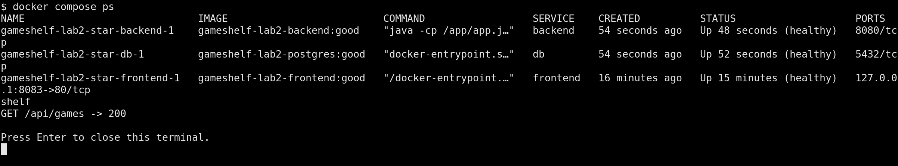
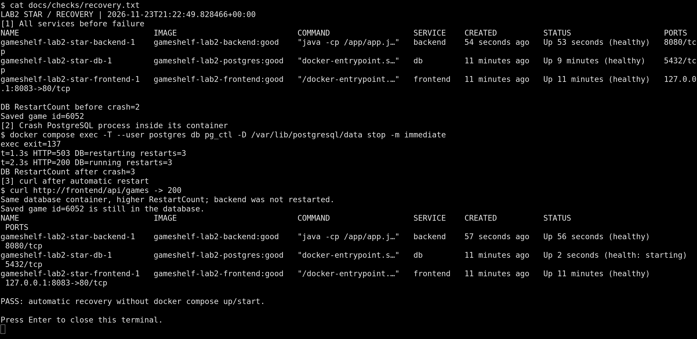
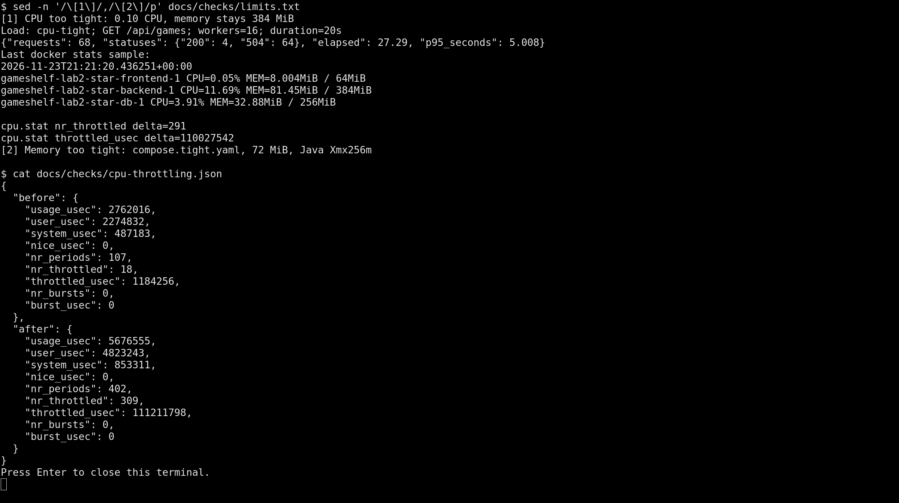
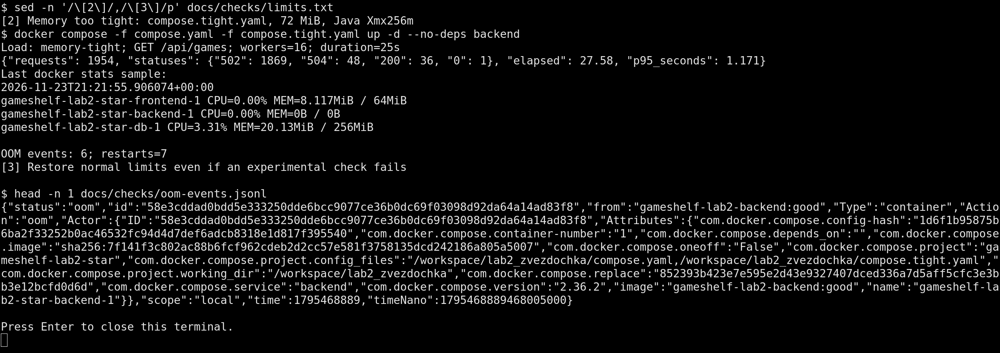
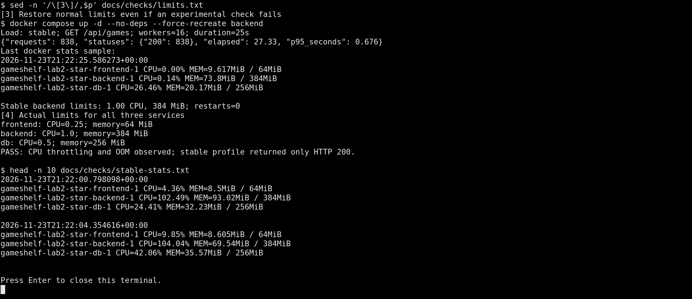

# Лаба 2*. проверяем как полка переживает неприятности

в обычной второй лабе всё спокойно работает в контейнерах. А здесь мы специально устроили две неприятности (Ухахахаха 😈): аварийно завершили psql, а потом дали бэкенду слишком мало cpu и памяти. И смотрели где стек восстановится сам, а где ему просто не хватает ресурсов (бедни 😢)

У звёздочки свой адрес, база и сompose проект. С предыдущими не связано и не трогает их

## как запустить

1. запустить docker desktop, так же на Windows нужен режим Linux containers
2. из корня клонированного репозитория перейти в папк:
   ```text
   cd lab2_zvezdochka
   ```

3. поднять обычную рабочую конфигурацию:

   ```text
   docker compose up -d --build
   ```

4. проверить что все три сервиса стали `healthy`:

   ```text
   docker compose ps
   ```

5. открыть [http://localhost:8083](http://localhost:8083), сохранить игру и обновить страницу

Код java, страница и dockerfiles берутся из соседней папки `lab2`. Это тот же сервис, поэтому не стали заводить вторую копию кода. Нужно клонировать весь репозиторий, но запускать обычную lab2 перед звёздочкой не надо



Файл запуска здесь свой: [compose.yaml](compose.yaml). Проект называется `gameshelf-lab2-star`, база хранится в `gameshelf-lab2-star_pgdata`, сайт занимает порт `8083`. У обычной lab2 порт `8082` и другой том

<details>
<summary>Рабочий Compose целиком</summary>

```yaml
name: gameshelf-lab2-star
services:
  db:
    image: gameshelf-lab2-postgres:good
    build: ../lab2/postgres
    environment:
      POSTGRES_DB: games
      POSTGRES_USER: postgres
      POSTGRES_PASSWORD: postgres_local
    volumes:
      - pgdata:/var/lib/postgresql/data
    restart: unless-stopped
    cpus: 0.50
    mem_limit: 256m
    memswap_limit: 256m
    shm_size: 64m
    networks: [data]
    healthcheck:
      test: ["CMD-SHELL", "pg_isready -h 127.0.0.1 -U postgres -d games"]
      interval: 3s
      timeout: 2s
      retries: 20

  backend:
    image: gameshelf-lab2-backend:good
    build: ../lab2/backend
    environment:
      DB_URL: jdbc:postgresql://db:5432/games?connectTimeout=2&socketTimeout=3
      DB_USER: gamer
      DB_PASSWORD: gamer_local
      INSTANCE_ID: lab2-star
    restart: unless-stopped
    cpus: 1.00
    mem_limit: 384m
    memswap_limit: 384m
    networks: [web, data]
    depends_on:
      db:
        condition: service_healthy

  frontend:
    image: gameshelf-lab2-frontend:good
    build: ../lab2/frontend
    restart: unless-stopped
    cpus: 0.25
    mem_limit: 64m
    memswap_limit: 64m
    ports: ["127.0.0.1:8083:80"]
    networks: [web]
    depends_on:
      backend:
        condition: service_healthy

  checker:
    profiles: [tools]
    build: ../lab2/tools
    image: gameshelf-lab2-tools
    volumes:
      - ../lab2:/workspace/lab2:ro
      - .:/workspace/lab2_zvezdochka
      - /var/run/docker.sock:/var/run/docker.sock
    working_dir: /workspace/lab2_zvezdochka
    entrypoint: ["python3", "-u", "tools/check.py"]
    networks: [web]

networks:
  web:
  data:
    internal: true
volumes:
  pgdata:
```

</details>

## что отвечает за восстановление

У всех трёх сервисов стоят `healthcheck` и `restart: unless-stopped`

база проверяется через `pg_isready`

java проверяется через `/health`: внутри выполняется `SELECT 1` к базе

nginx проверяет свой `/health`, т е способность отдавать http

В `depends_on` бэкенд ждёт здоровую бд, а фронт ждёт здоровый бэкенд. так java не пытается создать таблицу раньше, чем psql вообще начал принимать подключения

java открывает новое jdbc соединение для каждого запроса. Пока бд недоступна, api возвращает `503`. Когда psql снова готов, следующий запрос подключается заново. Бесконечного ожидания нет т к в jdbc заданы таймауты

## погасили бд, она вернулась сама

Cначала сохранили игру через api, потом внутри контейнера аварийно завершили psql:

```text
docker compose exec -T --user postgres db pg_ctl -D /var/lib/postgresql/data stop -m immediate
```

Это остановка моменталка процесса psql, после которой завершается контейнер. Специально не используем `docker compose stop` чтобы контейнер не возвращался

После сбоя скрипт **не вызывает** `up` или `start`. Он только смотрит состояние и опрашивает api. В реальном запуске получилось так:

```text
DB RestartCount before crash=2
Saved game id=6052
t=1.3s HTTP=503 DB=restarting restarts=3
t=2.3s HTTP=200 DB=running restarts=3
DB RestartCount after crash=3
$ curl http://frontend/api/games -> 200
Same database container, higher RestartCount; backend was not restarted.
Saved game id=6052 is still in the database.
```

id контейнера бд остался тем же, а `RestartCount` вырос. id бэкенда тоже не изменился: java не пришлось перезапускать. Игра, сохранённая до сбоя, осталась в базе. После восстановления `curl` снова получил `200`



Это восстановление после короткого перерыва, yj не полное отсутствие ошибок: во время падения был `503`. Статическая страница nginx при этом рбаотает

повторить из `lab2_zvezdochka`:

```text
docker compose build checker
docker compose run --rm checker recovery
```

Вывод: [recovery.txt](docs/checks/recovery.txt). Логи PostgreSQL и Java: [database-recovery.log](docs/checks/database-recovery.log). Сам скрипт: [tools/check.py](tools/check.py).

## что получилось с тесными лимитами

Нагрузку сделали из чтений `/api/games` через nginx. Скрипт временно добавляет 1500 тестовых игр, запускает 16 параллельных клиентов с паузой 50 мс после каждого ответа и параллельно снимает `docker stats`. После проверки временные игры удаляются, обычные остаются

`0.10 CPU` означает примерно десятую часть одного ядра, а `1.00 CPU` целое ядро. Контейнеру не выделяется отдельное физическое ядро, docker ограничивает доступное процессорное время.

Проверялb по шагам чтобы не путать нехватку cpu с нехваткой памяти:

1. мало cpu: бэкенду оставили `0.10 CPU`, память пока `384 мб`. Этот этап длится 20 сек
2. мало памяти: применили [compose.tight.yaml](compose.tight.yaml), где бэкенду разрешено только `72 мб`, а jvm может запросить heap до `256 мб`. Этот этап длится 25 сек и специально провоцирует oom
3. лимиты: вернули основной Compose и повторил ту же нагрузку 25 сек

У всех контейнеров `memswap_limit` равен `mem_limit`, то есть дополнительный swap не маскирует слишком тесную память контейнера.

### CPU

При ограничении `0.10 CPU` бэкенд упирался примерно в 10% одного ядра в `docker stats`. Но сам процент ещё не доказывает троттлинг, поэтому допом смотрим `cpu.stat` из cgroup, механизма учёта ресурсов контейнера в Linux. Счётчик `nr_throttled` вырос на **291**, время ожидания тоже увеличилось



Нагрузка на этом этапе дала 200: 4, 504: 64. Часть запросов не успела пройти за таймаут nginx.

### Память

На профиле `72 мб` Docker зарегистрировал **6 событий `oom`**. Это именно события oom от docker, а не вывод по одному коду `137`, который бывает и при обычном принудительном завершении

Во время теста были ошибки запросов и автоматические рестарты бэкенда. Политика `restart` возвращала процесс, но тесный лимит оставался тесным: одним перезапуском нехватку памяти не исправить (эхх минус вайбик)



Исходные доказательства: [oom-events.jsonl](docs/checks/oom-events.jsonl), [состояние контейнера](docs/checks/tight-container.json), [docker stats при тесной памяти](docs/checks/memory-tight-stats.txt), [счётчики CPU](docs/checks/cpu-throttling.json).

## на каких лимитах стало нормально

Compose оставил такие значения:

| Сервис | CPU | Память |
| --- | ---: | ---: |
| frontend | 0.25 | 64 мб |
| backend | 1.00 | 384 мб |
| db | 0.50 | 256 мб |

Повторная нагрузка дала **838 запросов, все с `200`**, без рестартов бэкенда. p95 времени ответа составил **0.676 с**, то есть 95% запросов уложились примерно в это время



| этап                 | ответы                            | p95, с |
|----------------------|-----------------------------------| ---: |
| мало CPU             | 200: 4, 504: 64                   | 5.008 |
| мало памяти          | 502: 1869, 504: 48, 200: 36, 0: 1 | 1.171 |
| рабочая конфигурация | 200: 838                          | 0.676 |

Код `0` в сводке означает обрыв соединения или неполный ответ. p95 в таблице учитывает и ошибочные запросы, поэтому низкое время ответа при oom не означает, что всё работает хорошо

Ограничение CPU осталось и в рабочем профиле, просто теперь его хватает для этой нагрузки

## как повторить нагрузку и остановить стенд

Из папки `lab2_zvezdochka`:

```text
docker compose build checker
docker compose run --rm checker limits
```

Скрипт сам переключает экспериментальные настройки. В конце возвращает основной Compose, дожидается API и удаляет только игры с префиксом `LAB2_LOAD_`. Проверяющий контейнер использует Docker socket для управления контейнерами именно этой лабы. Запускайте проверку один раз за раз, без параллельного `recovery`

Полный [вывод проверки](docs/checks/limits.txt), [сводка нагрузки](docs/checks/load-summary.json) и статистика: [CPU](docs/checks/cpu-tight-stats.txt), [тесная память](docs/checks/memory-tight-stats.txt), [рабочие лимиты](docs/checks/stable-stats.txt)

Если вручную прервёте проверку до восстановления, вернуть обычную конфигурацию можно так:

```text
docker compose up -d --force-recreate backend
```

посмотреть логи и остановить:

```text
docker compose logs --tail 50 backend db
docker compose down
```

